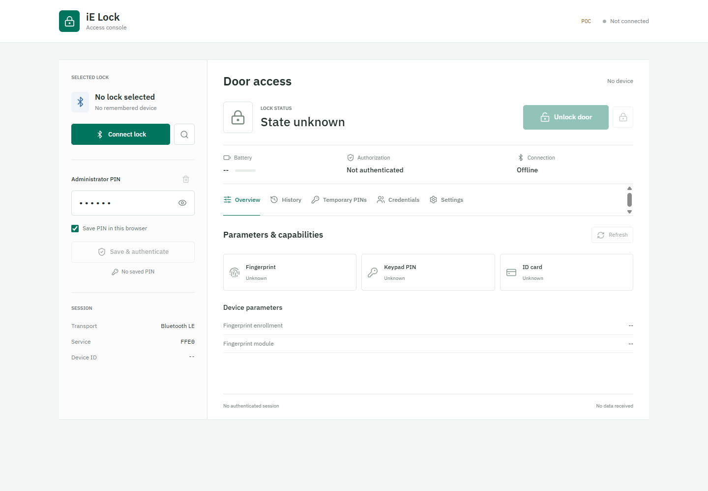

# iE Lock Web Console

A static browser client for compatible iE Lock Bluetooth door locks. Use it on
an iPhone through **Bluefy - Web BLE Browser**, or on Windows through a browser
with Web Bluetooth support, such as Chrome or Edge.

<table align="center">
  <tr>
    <td align="center">
      <h3>Open the live site</h3>
      
<strong><a href="https://i-am-shodan.github.io/iE-Lock-web-app/">iE Lock | Access Console</a></strong>

      
https://i-am-shodan.github.io/iE-Lock-web-app/

      
On iPhone, open this address in <strong>Bluefy</strong>, not Safari or Chrome. 
      No download or self-hosting required.

    </td>
  </tr>
</table>

## Preview

*The live console with no lock connected. No real lock data or saved credentials
are shown.*

This repository contains the ready-to-host site. No backend, Mac, Apple developer
account, Node.js installation, or server-side build is needed to publish it.

**Independent project:** This is not an official vendor application. Hardware
compatibility is limited by the evidence below; do not treat it as a guaranteed
replacement for the vendor app or your physical means of entry.

## Start Here

| I want to... | Go to |
| --- | --- |
| Open the published console | [iE Lock \| Access Console](https://i-am-shodan.github.io/iE-Lock-web-app/) |
| Connect from an iPhone | [Bluefy setup](#use-on-an-iphone-with-bluefy) |
| Check browser and hardware limitations | [Compatibility and validation](#compatibility-and-validation) |
| Publish my own copy or preview locally | [Hosting guide](docs/HOSTING.md) |
| Understand saved credentials | [PIN storage and privacy](#pin-storage-and-privacy) |
| Resolve a connection problem | [Troubleshooting](#troubleshooting) |
| Suggest a change or report compatibility | [Contributing](CONTRIBUTING.md) |
| Report a security concern privately | [Security policy](SECURITY.md) |
| Read the Android protocol research | [App analysis and evidence ledger](docs/IE_LOCK_APP_ANALYSIS.md) |

## Before You Start

- Use only with a lock you own or are authorized to manage.
- Keep the door physically accessible during initial testing.
- The owner has confirmed that manual unlocking works. The remaining management
  operations were reconstructed from the Android app and tested with a simulated
  lock; compatibility with every firmware version is not guaranteed.
- **Factory reset erases lock credentials and data.** Do not use it just to test
  connectivity. Deletions and access changes can also remove someone's access.
- A timeout does not prove that a command failed. Check the physical lock before
  retrying an unlock or destructive operation.

## Features

- Connect to a compatible Bluetooth Low Energy lock and remember the selection.
- Authenticate using a six-digit Bluetooth administrator PIN, optionally saved
  encrypted in this browser.
- Explicitly unlock or close the lock and read its state and battery level.
- Read device parameters, capabilities, unlock history, and temporary PINs.
- Manage mobile users, fingerprints, keypad PINs, and supported ID cards.
- Rename the Bluetooth device, change the administrator PIN, or explicitly reset
  the lock to factory settings.

Some features require an administrator role or hardware capability reported by
the lock. Unsupported controls stay disabled. Background or automatic proximity
unlocking is not implemented.

## Compatibility and Validation

| Environment or operation | Current expectation / evidence |
| --- | --- |
| iPhone with Bluefy | Intended iPhone access path; requires Bluetooth permission and a trusted HTTPS origin. |
| Windows with Chrome or Edge | Requires Web Bluetooth availability, compatible Bluetooth hardware, and permission to use it. Browser or organization policies may block access. |
| Ordinary iPhone Safari or Chrome | Not supported for this BLE workflow; use Bluefy instead. |
| Other browsers and operating systems | Not established by this repository. A secure origin alone does not provide Web Bluetooth support. |
| Manual unlocking | Confirmed by the owner; not a certification of all lock models or firmware. |
| Management operations | Reconstructed from Android send paths and tested with a simulated lock, not validated across physical lock firmware. |
| Background / proximity unlocking | Not implemented. Keep the site in the foreground and unlock explicitly. |

There is no verified model-by-model compatibility list yet. Matching branding or
a Bluetooth device name is not enough to establish compatibility. Capability
checks can disable unsupported controls, but cannot prove that every enabled
operation behaves correctly on a particular lock.

The [Android analysis](docs/IE_LOCK_APP_ANALYSIS.md) documents a specific APK and
distinguishes observed behavior, inferences, and unknowns. It is historical
research evidence, not a physical-hardware test report for this web client.
Share sanitized compatibility results using the
[contribution checklist](CONTRIBUTING.md#reporting-bugs-and-compatibility).

## Use on an iPhone with Bluefy

The browser is named **Bluefy**, sometimes mistyped as Bluefly.

1. Install [Bluefy - Web BLE Browser](https://apps.apple.com/us/app/bluefy-web-ble-browser/id1492822055)
   from the App Store.
2. Turn on Bluetooth on the iPhone. Allow Bluefy to use Bluetooth when requested.
   If you previously denied permission, enable it for Bluefy in iOS Settings.
3. Move within Bluetooth range of the lock. Wake the lock using its normal
   controls if it is not advertising, and close other lock apps if they are
   holding the connection.
4. Open **Bluefy itself** and enter
   **https://i-am-shodan.github.io/iE-Lock-web-app/** in its address bar.
   Bookmark that address in Bluefy for future use.
5. Select **Connect lock**, then choose the intended physical lock in the device
   chooser. Connection checks the expected service and characteristics before
   transmitting a PIN.
6. Confirm or edit **Administrator PIN**. The public factory default `123456`
   is prefilled only when there is no saved PIN. Use your actual administrator
   password if it has been changed. This Bluetooth password is not necessarily
   the same as a separately registered keypad PIN.
7. Leave **Save PIN in this browser** checked to save the PIN after successful
   authentication, or uncheck it for a session-only login. Select **Save &
   authenticate** or **Authenticate**, as appropriate.
8. Check the authorization, battery, and lock-state readings. Authentication
   does not automatically unlock the door.
9. Select **Unlock door** explicitly when you intend to unlock it. The adjacent
   lock-icon button is **Close door**, for firmware that supports that command.

Use the website in the foreground. Ordinary iPhone Safari, Chrome, and a Safari
home-screen shortcut do not gain Web Bluetooth support just because the site
uses HTTPS. Bluefy supplies the native Bluetooth bridge required here.

You do not need to find the lock in iOS Settings first. This console cannot list
system-paired devices: a remembered selection means a device selected for this
site, not proof that it is currently nearby or connected.

### Reconnect Later

Open the same HTTPS address in Bluefy and select **Reconnect**. If Bluefy cannot
enumerate previously authorized devices, choose the lock again when prompted.
A saved PIN can authenticate automatically after connection, but unlocking
remains an explicit button press.

## Read Device Data

- **Overview:** Read or refresh the lock state, battery, capabilities, and
  enrollment information. Unidentified values remain under **Vendor-specific
  fields** and **Raw parameters** instead of being assigned guessed meanings.
- **History:** Select the tab and **Refresh** to fetch records. Search by name or
  method. Dates are packed lock calendar values displayed as lock time (GMT+8),
  not Unix timestamps. The original year format is limited to 2000-2031.
- **Temporary PINs:** Select the tab and **Refresh**. Values are fetched from the
  lock, not generated by the website, and remain masked until revealed. Expiry
  and reuse rules depend on the firmware and are not established by this client.

## Manage Credentials

1. Authenticate with an administrator account and open **Credentials**.
2. Choose **Mobile users**, **Fingerprints**, **Keypad PINs**, or **ID cards**.
3. Select **Refresh** to read that list from the lock.
4. Use **Add** for a mobile user or keypad PIN, or **Enroll** for a fingerprint
   or supported card. Enter the requested name and, where applicable, the PIN.
5. For physical enrollment, follow the status in the dialog and interact with
   the lock's sensor or reader. Keep Bluefy open until completion. **Disconnect
   & cancel** ends the browser connection; it does not guarantee that the lock
   rolls back partial enrollment.
6. Existing records offer the operations supported by the original protocol:
   rename, change a keypad PIN, restrict access, or delete. Each destructive or
   restriction change requires confirmation. The primary mobile-user record is
   protected in this client.

Credential names must fit eight GB2312 bytes, typically eight ASCII or four
Chinese characters. Mobile-user passwords contain six digits; keypad PINs can
contain 1-8 digits as supported by the original app. Prefer a strong PIN and
avoid the factory default. Returned PINs remain masked until explicitly shown.

Mobile-user renaming and editing an existing mobile user's password individually
are not exposed by the inspected Android send paths, so no speculative command
is provided. Cards remain disabled when the lock does not report card support.

## Settings

- **Bluetooth name:** Requires at most thirteen UTF-8 bytes. The remembered name
  updates after the lock acknowledges the change.
- **Administrator PIN:** Enter and confirm a new six-digit PIN. The lock must
  acknowledge the change before saved local credentials are updated. The app
  then disconnects; reconnect using the new PIN.
- **Factory reset:** Requires exact typed confirmation `RESET`. It erases lock
  data. After acknowledgement, this browser's saved PIN and device selection
  are cleared. It does not erase other phones' or websites' local data.

## PIN Storage and Privacy

Saved PINs use AES-GCM encryption in IndexedDB with a non-exportable key and are
associated with the selected browser device ID. This is not iOS Keychain or
hardware-backed user authentication. Code running on the same origin can use the
stored key, so trust the hosting account, website updates, and browser profile.
Other pages on the same origin can share browser storage; do not co-host
untrusted applications there.

- The site has no backend that receives your entered PIN or controls the lock.
  The phone communicates directly with the lock over Bluetooth.
- Credential lists, history, and temporary PINs remain in memory and clear on
  disconnect. The application does not log raw PIN-bearing packets.
- **Forget saved PIN** removes the local saved entry and disconnects. It does
  not change the lock's password or revoke credentials held by the firmware.
- Clearing site data, private browsing, a different browser, another hostname,
  or a changed device identifier can require selecting the lock and saving the
  PIN again.
- Protect the phone and hosting account. Browser-side storage encryption does
  not strengthen the lock's underlying Bluetooth protocol or protect against
  malicious JavaScript served from a compromised site.

## Troubleshooting

| Symptom | Checks |
| --- | --- |
| Web Bluetooth unavailable | Open the site inside Bluefy, not ordinary Safari. Confirm Bluetooth permission. |
| HTTPS required | Use the published HTTPS address, not a local file or ordinary LAN HTTP URL. Do not rely on an untrusted/self-signed certificate. |
| No lock in the chooser | Move closer, wake the lock, and disconnect other apps using it. Select only your intended device. |
| Authentication rejected | Check the Bluetooth administrator password, not just a keypad PIN. Some firmware may require local fingerprint approval. |
| Management disabled | Confirm administrator authorization. Check whether the lock reports the selected hardware capability. |
| Saved PIN missing | Use the same Bluefy profile and site origin; check whether private browsing or cleared site data removed it. |
| History error | Reconnect and retry the read. Report the displayed response length/status if it persists; do not publish personal records or credentials. |
| Timeout after unlock or a change | Inspect the actual lock first. A command may have completed despite a lost reply. Reconnect and refresh before deciding whether to repeat it. |
| Stale site after an update | Reload in Bluefy and, if necessary, clear the page cache. Clearing all site data also removes the saved PIN. |

## Updating This Repository

Replace the static site files with a new built release, commit, and push to the
publishing branch. Keep the Git metadata and repository documentation; never add
saved browser data, personal PINs, or raw diagnostic captures to the repository.
Upload the matching HTML, JavaScript, CSS, fonts, and icons as one release.
No server-side build or package installation is required for this distribution.
See the [hosting and update checklist](docs/HOSTING.md#updating-and-rolling-back)
before publishing.

## Repository Layout

| Path | Purpose |
| --- | --- |
| [`index.html`](index.html) | Static entry point referencing the prebuilt bundles. |
| [`assets/`](assets/) | Generated JavaScript, CSS, and bundled fonts. |
| [`favicon.svg`](favicon.svg), [`icons.svg`](icons.svg) | Site icons. |
| [`.nojekyll`](.nojekyll) | Disables Jekyll processing for branch-based GitHub Pages publishing. |
| [`docs/`](docs/) | Hosting instructions and Android app research. |
| [`CONTRIBUTING.md`](CONTRIBUTING.md), [`SECURITY.md`](SECURITY.md) | Contribution and private-reporting guidance. |

This checkout is a **prebuilt distribution**, not a source development project:
it does not include a package manifest, original application source, build
commands, or an automated test suite. Do not expect `npm install`, `npm run dev`,
or `npm test` to work here.

## Contributing and Support

Documentation improvements and carefully described compatibility reports are
welcome. Read [Contributing](CONTRIBUTING.md) for what to include, how to validate
a documentation change, and how to keep reports free of sensitive lock data.
Use repository issues for ordinary bugs and feature requests when available;
use the [security policy](SECURITY.md) for vulnerabilities. No response-time or
hardware-support guarantee is implied.

## License

The repository includes an [MIT license](LICENSE), copyright 2026 i-am-shodan.
Preserve applicable notices when redistributing. That license is not a claim of
ownership of the vendor application, vendor trademarks, or third-party assets;
check applicable third-party license and notice requirements when redistributing
a built release.