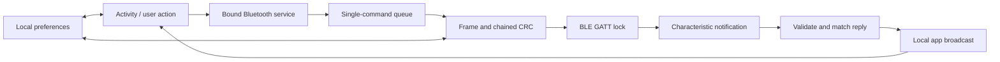

# iE-Lock 1.2.0: How the App Works

Analysis date: 2026-11-09.

## Summary

**This is primarily a local Bluetooth Low Energy controller, not a cloud-based
lock service.** The inspected Android build has no Internet permission, and the
traced control paths communicate directly with the lock. A vendor account or
server is not part of those paths. (E1, E3-E6)

The phone discovers a compatible lock, authenticates with a password or a saved
lock-issued credential, and sends commands for opening, closing, and management.
The lock performs fingerprint enrollment; the app supplies a name and displays
progress. Keypad passwords, optional ID cards, mobile users, and unlock history
have separate management paths. (E8-E18)

The APK contains enough information to make a replacement client a realistic
prospect. It is not yet a tested protocol specification: no physical lock was
connected, and this Android artifact cannot explain the separate iOS app's
failure on current iOS.

## Scope and Method

Analysis used REA 6.8.0, its archive inventory, and its JADX 0.7.1 Android
provider. The missing JADX engine was downloaded from REA's pinned upstream
release and checked against REA's expected SHA-256. Java 21 was already
installed. Android analysis used REA's CLI with terminal-only environment
settings; no VS Code MCP configuration was changed.

The APK was not installed or launched. No radio traffic was captured, no vendor
endpoint was contacted, and no unlock, enrollment, deletion, or reset command
was transmitted. Selected application methods were inspected, not every code
path in the APK.

In this report, **observed** means present in the artifact or recovered code;
**inferred** means an interpretation of that code; **unverified** means a live
app, lock, firmware, or other artifact is needed. The evidence ledger at the
end gives exact REA IDs and method selectors.

## Artifact Identity

| Property | Observed value |
| --- | --- |
| Supplied file | `iE-Lock_1.2.0_APKPure.apk` |
| APK SHA-256 | `dead7e8ec54e222936887761d0878e61f052704951d3128b937785b7b171c81f` |
| Android package | `com.yuwentong.smartlock.neutral` |
| Version | `1.2.0`, version code `8` |
| Minimum / target Android SDK | `19` / `30` |
| Application class | `com.yli.smartlock.application.CHYApplication` |
| Launcher activity | `com.yli.smartlock.activity.CHYMainActivity` |
| Parsed classes / resources | `588` / `590` |

The decoded manifest requests legacy Bluetooth, location, vibration, overlay,
and network-state permissions, but not `android.permission.INTERNET`. It also
sets `android:allowBackup="true"`. Those are declarations, not proof of actual
permission grants, backup availability, or trustworthiness. APKPure's filename
does not establish the publisher's identity or signature authenticity. (E1)

The code namespace is `com.yli.smartlock`, despite the different installed
package name. Many helpers have obfuscated names, so this report assigns
descriptive roles without treating those names as original source symbols.

## Application Architecture

| Component | Responsibility |
| --- | --- |
| `CHYMainActivity` | Connection UI, authentication results, open/close, battery, capability and state queries |
| `HYBluetoothManager` | Android service owning scanning, GATT, notifications, command queues, and timeouts |
| `HYBluetoothManager.p` | Bound-service interface used by activities to enqueue commands |
| `com.yli.smartlock.until.a` | Packet construction, reply validation, random bytes, and byte-array helpers |
| `com.yli.smartlock.until.d` | Shared state and local preferences, including saved credentials |
| Management activities | Mobile users, fingerprints, keypad PINs, ID cards, temporary passwords, and history |



The main activity and Bluetooth service each create background handler threads.
UI work is returned to the main thread. Replies are routed through local
broadcasts containing a command type, decoded data, and an originating-screen
tag such as `main`, `touch`, or `password`. (E5, E6, E7)

## Normal Connection and Use

### 1. Discover a Compatible Lock

The service uses Android's legacy BLE scanning API. Its scan callback accepts
advertisements whose raw bytes at offsets 5 and 6 are `F0 FF`. This is a fixed
offset test, not a general advertisement-data parser. Do not equate that filter
with the separate GATT service UUID below. (E3)

The Android implementation associates saved credentials with the selected
device's Bluetooth address. The GATT-setup path records that address as the
currently selected lock. (E4, E19)

### 2. Establish the BLE Data Channel

| Purpose | UUID |
| --- | --- |
| Service | `0000ffe0-0000-1000-8000-00805f9b34fb` |
| Phone-to-lock writes | `0000ffe9-0000-1000-8000-00805f9b34fb` |
| Lock-to-phone notifications | `0000ffe4-0000-1000-8000-00805f9b34fb` |

The service rejects a connection without these characteristics. It enables
notifications and writes `ENABLE_NOTIFICATION_VALUE` to the notification
characteristic's descriptors, then starts authentication after a successful
descriptor write. The code iterates all descriptors rather than selecting a
hard-coded descriptor UUID. (E4, E7)

### 3. Authenticate

The app stores three registration states: `0` for no saved registration, `1`
for password authentication, and `2` for a saved lock-issued credential.

For a lock without a saved login, a dialog requires a six-character password.
The dialog itself checks length; later packet construction parses the value
as a decimal integer. This is not a vendor-cloud login. (E8, E9, E19)

| Command | Observed authentication payload |
| --- | --- |
| `0x00` | Password as a three-byte little-endian integer, followed by a four-byte packed date/time |
| `0x01` | One-byte saved user role, saved credential bytes, then the packed date/time; the inspected successful enrollment reply supplies a two-byte credential |

The time is constructed in fixed `GMT+8:00`, not the phone's selected time zone.
It packs year-minus-2000, month, day, hour, minute, and second into bit fields
starting at bits 26, 22, 17, 12, 6, and 0, and sends the resulting integer
little-endian. The packet-chain state is reset before authentication. (E8)

An authentication reply beginning with status `9` supplies a two-byte
credential and a role byte, with an optional battery value. The app saves the
credential and changes to registration state `2`, except for a special role
value of `0xFF`. Status `1` is another accepted success result. Role `1` is
treated by the UI as administrator. (E10, E11)

**Decompilation caveat:** JADX reports duplicated branches in the authentication
sender. The payload-building operations are visible, but its exact branch and
send ordering must be corroborated before implementing a client. It should not
be copied as if the recovered Java were the original source. (E8)

### 4. Read Capabilities, Operate, and Update the UI

After authentication, the main activity requests device parameters using
`0x11`, then temporary passwords using `0x0C`. Parameters contain numeric values
and capability bits used to gate fingerprint, PIN, and card features. The app
also has a lock-state query, `0x14`. (E12, E16)

Opening sends `0x08`; closing sends `0x13`. Each of those requests has a random
single-byte payload in addition to the frame's own random bytes. Success
replies include battery and lock state, which update the main screen. This
build explicitly supports both operations, but the actual hardware's mechanical
close behavior still needs checking. (E13)

## Credential and History Workflows

### Mobile Users and Administrator Access

`CHYAdminActivity` manages named mobile-user credentials separately from the
keypad-PIN screen. Adding a user sends an eight-byte name field and a numeric
password encoded in three little-endian bytes. Deletion addresses a user by ID;
another operation changes a per-user role/setting. Main-screen management
actions check for administrator role `1`. These UI checks do not prove which
permissions the lock firmware independently enforces. (E11, E14)

### Fingerprints

The administrator enters a name, and the phone sends an enrollment command
with an eight-byte name field encoded through `GB2312`, not UTF-8. The lock
returns enrollment progress/status events, and the app displays a fingerprint
progress dialog. This inspected path sends a name, not a phone-captured
fingerprint image or template. Capture and matching are therefore functions of
the lock in this workflow. (E15)

The app can also rename and delete fingerprint records by ID. There is a
per-fingerprint setting command, but the full meaning of its numeric choices
has not been established here.

### Keypad PINs

`CHYPasswordActivity` provides named PIN records with add, delete, rename, and
password-update operations. Unlike the mobile-user password, a keypad PIN is
serialized as a four-byte little-endian integer, followed by a type field
derived from the record's password-type value. The full type enumeration and
all allowed PIN lengths remain unverified. (E17)

The six-character mobile-login requirement must not be blindly applied to
every keypad-PIN or temporary-password field: they are different code paths.

### Optional ID Cards

There is a separate capability-gated ID-card screen. Enrollment sends a name
to the lock; rename and deletion operate on card record IDs. This supports an
inference that the lock reads the card during enrollment. The APK methods
inspected do not establish the card's frequency, technology, or compatibility
with the user's particular lock. (E18, E22)

### Temporary / Dynamic Passwords

The lock, not the phone, supplies these passwords. Command `0x0C` returns a
packed representation of five values: two bytes per value plus a packed
four-bit extension. The app reconstructs each value and left-pads its decimal
representation to at least six digits. It then caches the five strings. (E16)

`CHYDynamicPasswordActivity` simply displays that cached list. It does not
calculate TOTP, contact a server, or implement an expiry scheduler. The
preferences key is global `PasswordList`, not a per-address key, so cached
codes should not be assumed to belong to a newly selected lock before refresh.
Their expiration, reuse rules, and invalidation behavior are not established
by this display-and-cache path. (E16, E20)

### Unlock History

`CHYUnlockrecordActivity` parses a streamed response. An initial status `3`
supplies a two-byte little-endian record count, followed by records containing
an eight-byte `GB2312` name, a four-byte encoded time field, and a flags byte.
The parser extracts bit `0x40` and method bits 3-5 from the flags. (E21)

The complete method-label mapping and time-display conversion were not traced.
In particular, the four-byte time value should not be assumed to be a Unix
timestamp merely because it fits in an integer.

### Other Settings

The settings action handler references lock-name and password-change screens,
the credential screens, history, an About screen, and a reset-lock confirmation
dialog. Restricted actions check administrator status and, where applicable,
connection/authentication state. Reset was inspected only as code and was not
executed. (E22)

Not every referenced screen is registered in this APK's manifest: for example,
the compiled About and registration activities are absent from its activity
declarations. The settings menu also has duplicated-branch decompiler warnings.
Consequently, a compiled destination is not proof of a working, visible menu
entry in this particular build. (E1, E22)

## BLE Protocol Structure

### Frame Layout

Observed outgoing frames have this structure: (E5)

```text
FA | total_length | command | command_payload | random_0 | random_1 | crc_0 | crc_1
```

| Field | Size | Meaning |
| --- | --- | --- |
| Start | 1 byte | `0xFA` |
| Length | 1 byte | Entire frame length, including checksum |
| Command | 1 byte | Operation code |
| Payload | Variable | Command-specific bytes |
| Random suffix | 2 bytes | Generated with Java `Random` seeded from current milliseconds |
| Checksum | 2 bytes | Chained CRC described below |

The minimum overhead is seven bytes. Incoming decoding verifies the start,
length, command, and checksum, then removes the three-byte header and the
four-byte random/checksum suffix to expose the command payload. (E6)

### Chained CRC, Not Application-Layer Encryption

The checksum uses CRC-16/MODBUS tables and initial CRC register `0xFFFF`.
The helper's integer return swaps the conventional CRC byte significance;
the bytes emitted on the wire are the conventional CRC's low byte followed by
its high byte. The complete tables are retained in the evidence. (E23)

Crucially, the app also maintains a separate two-byte **previous-checksum
state**. This is distinct from the CRC algorithm's initial register:

1. Authentication resets the previous-checksum state to `00 00`.
2. To send, append the previous-checksum bytes to the frame prefix through its
	 random suffix, calculate the CRC, and put that result in the transmitted
	 checksum field instead.
3. Save the transmitted checksum as the new state.
4. To receive, substitute the current state for the received checksum field,
	 calculate and compare the CRC, then adopt the received checksum on success.

Thus a stateless packet encoder is insufficient. Ordering, failures, retries,
and reconnection must preserve or deliberately reset the chain correctly.
The exact retry/resynchronization behavior remains a live-validation item.
(E5, E6, E8)

The inspected encoder does not encrypt the command payload or use a
cryptographic MAC. The random values use `Random`, not `SecureRandom`. A CRC
chain is not equivalent to cryptographic authentication. This does **not**
establish whether the BLE link itself requires pairing or link-layer encryption;
that needs device behavior or a radio capture.

### Queue and Replies

Only one command is driven at a time through the service's worker queue.
Notifications are accepted while a current request is active, and decoded
replies must match that request's command type. The service has special handling
for multi-response operations and a timer running at one-second intervals.
An unsolicited-notification-first design would not reproduce this request/reply
model. (E7)

### Selected Confirmed Commands

This is a non-exhaustive map from actual send sites, not a list inferred only
from strings. All values below are hexadecimal.

| Command | Observed operation | Code anchor |
| --- | --- | --- |
| `00` | Password authentication | `HYBluetoothManager.m0` |
| `01` | Saved-role/credential authentication | `HYBluetoothManager.m0` |
| `02` | Add named mobile user | `CHYAdminActivity.z` |
| `03` | Delete mobile user | `CHYAdminActivity.F` |
| `06` | Start fingerprint enrollment | `CHYTouchActivity.H` |
| `07` | Delete fingerprint | `CHYTouchActivity.P` |
| `08` | Open | `CHYMainActivity.s0` |
| `0B` | Change per-fingerprint setting | `CHYTouchActivity.J` |
| `0C` | Fetch five temporary passwords | `CHYMainActivity.i0` |
| `0D` | Rename fingerprint | `CHYTouchActivity.I` |
| `11` | Read device parameters/capabilities | `CHYMainActivity.k0` |
| `12` | Change mobile-user role/setting | `CHYAdminActivity.A` |
| `13` | Close | `CHYMainActivity.r0` |
| `14` | Read lock state | `CHYMainActivity.j0` |
| `16` | Add keypad PIN | `CHYPasswordActivity.G` |
| `17` | Delete keypad PIN | `CHYPasswordActivity.Q` |
| `18` | Rename keypad PIN | `CHYPasswordActivity.H` |
| `1A` | Start ID-card enrollment | `CHYIDCardActivity.D` |
| `1B` | Delete ID card | `CHYIDCardActivity.L` |
| `1C` | Rename ID card | `CHYIDCardActivity.E` |
| `1F` | Update keypad PIN/type | `CHYPasswordActivity.I` |

## Local Data and Security Implications

The singleton uses private Android `SharedPreferences` named `bluetooth`.
Observed keys include: (E19, E20)

| Key | Stored value |
| --- | --- |
| `UserPassword` + device address | Password as a string |
| `ID_Key` + device address | Lock-issued credential as uppercase hexadecimal |
| `RegisterType` + device address | Authentication/registration mode |
| `UserType` + device address | User role |
| `PasswordList` | Globally cached list of temporary passwords |

The credential codec is hexadecimal conversion, not encryption. The password
setter stores its input string directly. Android's sandbox still applies, but
the app itself adds no encryption in these storage paths. Backups and any
future migration/export tooling must therefore be treated as sensitive.
`allowBackup=true` alone is not proof that another app can read these values.

## Implications for a Replacement iOS Client

**Inferred:** a replacement should be possible without replacing the lock or
recreating a vendor cloud, for the functions traced here. A sensible first
implementation would support discovery, explicit authentication, state/battery,
and manual open/close before adding credential management.

The important compatibility details are:

- Use CoreBluetooth and the observed service/characteristics, not Android APIs.
- Do not use the Android MAC-address preference key as an iOS identity scheme;
	CoreBluetooth's peripheral identifiers and a verified lock-identity strategy
	are needed instead.
- Retain the packed `GMT+8` timestamp, integer byte order, `GB2312` name fields,
	CRC byte order, and rolling state until device testing establishes otherwise.
- Keep mobile-login credentials, keypad PINs, and cached temporary codes distinct.
- Store future credentials in the iOS Keychain rather than copying the Android
	plaintext-storage design.
- Treat fingerprint/PIN/card features as capability-dependent, not universal.

The initial test must use the owner's known credentials and a lock kept
physically accessible. Reset and credential-deletion operations are unnecessary
for validating a basic replacement and should not be used as initial probes.

There is no basis in this APK alone to identify an iOS signing, architecture,
permission, Bluetooth-lifecycle, or OS-compatibility failure. That requires the
original iOS artifact or its error/crash evidence.

## Coverage and Remaining Unknowns

| Question | Status |
| --- | --- |
| App architecture and local/cloud split | Answered for the manifest and traced control paths |
| GATT channel, frame layout, and CRC chain | Recovered statically; physical interoperability unverified |
| Password and saved-credential modes | Recovered; duplicated authentication branches need corroboration |
| Fingerprint, keypad-PIN, and optional-card workflows | Core send/result paths traced; full setting enumerations not mapped |
| Temporary passwords | Fetch, unpack, cache, and display traced; expiry/reuse rules unknown |
| Unlock history | Stream parser traced; complete request and display semantics not mapped |
| BLE pairing and link-layer encryption | Unverified |
| Firmware variants, fragmentation, and retry recovery | Unverified or only partially traced |
| Exact visible menus on this APK | Not runtime-tested; some destinations are undeclared |
| Cause of the iOS app failure | Not answerable from this Android APK |

JADX fell back to Smali for several constructors and the checksum-table
initializer. Smali was retained and used where applicable. Duplicated-code
warnings in authentication and settings are explicit limitations, not evidence
that the original app necessarily executes duplicate operations.

## Evidence Ledger

The canonical bundle [rea-evidence.json](rea-evidence.json) contains 123 complete
REA records, including 99 selected method inspections. REA authenticated the
records and their artifact/provider manifests on import, then exported the
combined bundle. IDs below identify primary records; related methods are also
retained under their exact class and method selectors.

[verification.json](verification.json) records the artifact/citation checks and
the offline CRC check. Both 256-entry tables match CRC-16/MODBUS, and ASCII
`123456789` produces wire bytes `37 4B`. This checks the recovered checksum
algorithm, not a physical lock or the complete firmware protocol. These are
static observations and local derivation checks, not captured lock sessions.

| Ref | Primary REA observation | Evidence ID |
| --- | --- | --- |
| E1 | Package, manifest, SDKs, permissions | `ev_caecef034138fdfd803333093f2bc48df9c6592527d3235cb4f574e4c250e576` |
| E2 | APK archive inventory | `ev_8b35417f3553f2b32f18cb5d062f36cc53c7d83da2117993783efae6d769dcc6` |
| E3 | `HYBluetoothManager.m.onLeScan` | `ev_f9e429a6e032bb3e10e77260522861e7a10efc82edff107075a7f91bcd681ce1` |
| E4 | `HYBluetoothManager.k0`: GATT selection | `ev_910d0ff3adfa16579436f93b6ab93e6b0af3ed65ca10dae03b7f730d4424ec79` |
| E5 | `until.a.l`: frame construction | `ev_3299841d4f700078c8fbe5112eb0a1b3d9aeb7ecd5f2d68b9a1d3ad48534d9d4` |
| E6 | `until.a.u`: frame validation | `ev_3e891dd39ff287881fce7a0d5fbd830af5be70fbb182726f263ba86e8d74cdcc` |
| E7 | `HYBluetoothManager.n0`: reply dispatch; related queue/callback methods retained | `ev_03ad3815f3962daa23c2ed240c39c2a344e8ba2fe9554aa79db7cb752a29a05e` |
| E8 | `HYBluetoothManager.m0`: authentication sender | `ev_a02ebbb50caccc4117934aece2698b9cada9ac81b49645dfdfcd22a192e8b52c` |
| E9 | `HYBluetoothManager.e.onClick`: password validation | `ev_635415c4dda3d5024c21fad6a86ed7038ccbc54ca0b9840e2edd099e83158523` |
| E10 | `CHYMainActivity.l0`: authentication replies | `ev_09f83aac54b63465258efc2bb66280d037838881c0a67f0de844dd3554732706` |
| E11 | `CHYMainActivity.buttonsAction`: administrator gating | `ev_3a698d9f018c6ed0d9287d88032b75c5ce600b0926b2ebacd0e0563ebced95c5` |
| E12 | `CHYMainActivity.p0`: parameters/capabilities | `ev_f1c4a7df092d58928673e50b9f00d9e9131ce6150ced33dcbb28841457a92879` |
| E13 | `CHYMainActivity.s0`: open; related close and reply methods retained | `ev_9385ac8bf3c8c9b11d1bfd15a482f8b03cf0842f144a07ddf3bf394045245af5` |
| E14 | `CHYAdminActivity.z`: named mobile-user creation | `ev_af8f39be3402c26bb39a22b4ee9029fee9107d3d542a3e90252a04bca1db6849` |
| E15 | `CHYTouchActivity.H`: fingerprint enrollment | `ev_670eff1d62645316a2be1f5b05e3ae4ebabe5ac3c0628fcf1afc94df12ba03f2` |
| E16 | `CHYMainActivity.n0`: five temporary-code unpacking | `ev_0842f70965b86dadca4fc0432d2a5b880b0001f96226e89e2277f857bf67e29f` |
| E17 | `CHYPasswordActivity.G`: keypad-PIN creation | `ev_4ae53bc51cab2e50de46ed49156dc173ee110d728f3257b204b7e672f1efdd18` |
| E18 | `CHYIDCardActivity.D`: ID-card enrollment | `ev_ad01d1ba194952202622147b1564e3ca917de758b115942a4dcbfcf0a9ff4429` |
| E19 | `until.d.G`: saved credential; related password/mode/role/codec methods retained | `ev_21a36c887bf2ba3e54c5857aff805c1e1109e308417b1a6cac86aced94638024` |
| E20 | `until.d.L`: global temporary-password cache | `ev_0fa0a6db1863382ea63c0f21c6a7509cac14ae3ad969c03843acdbbd85a33db6` |
| E21 | `CHYUnlockrecordActivity.f`: history stream parser | `ev_e82c702757ae92c1ce376e217adc68089da3a4e447c54cab4df14450ba23f526` |
| E22 | `CHYMoreActivity.k.onItemClick`: settings actions | `ev_23070a5af34f711e0245bf9512f803792d49eaeba56fecb4090a719b9d01e813` |
| E23 | Checksum tables; `b.a.a.a.a.a/b/c` also retained | `ev_f57a3b82af8c690c15a9500f3397c092e0255ed77c1fb2cb978844a08ebcfe2b` |